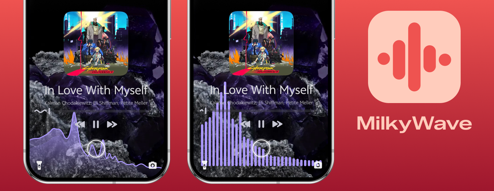

# Milky Wave

An LSPosed module for OriginOS that adds a live audio visualizer directly on the lock screen.

## Build

Requires **JDK 17** and **Android SDK 35** (`ANDROID_HOME` set or `sdk.dir=...` in `local.properties`).

```bash
# Using Make (creates dist/*.apk)
make

# Or using Gradle directly
./gradlew :app:assembleDebug
```

The built APK is located at `dist/*.apk`.